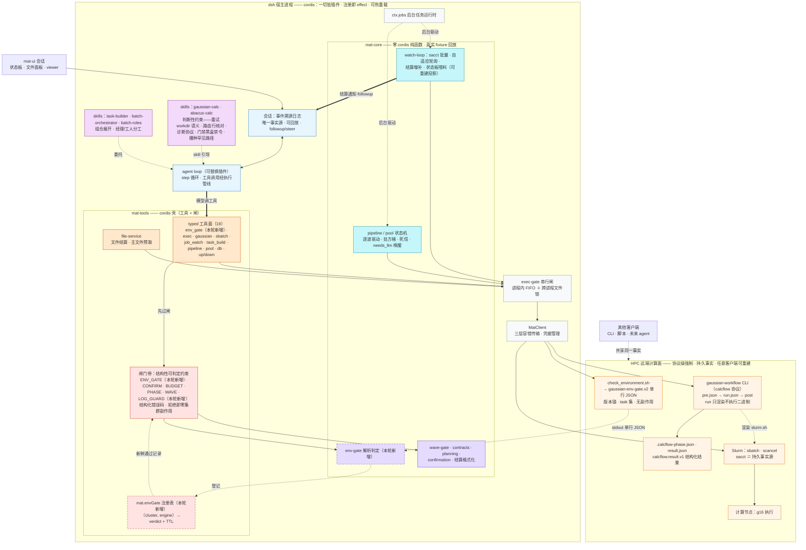
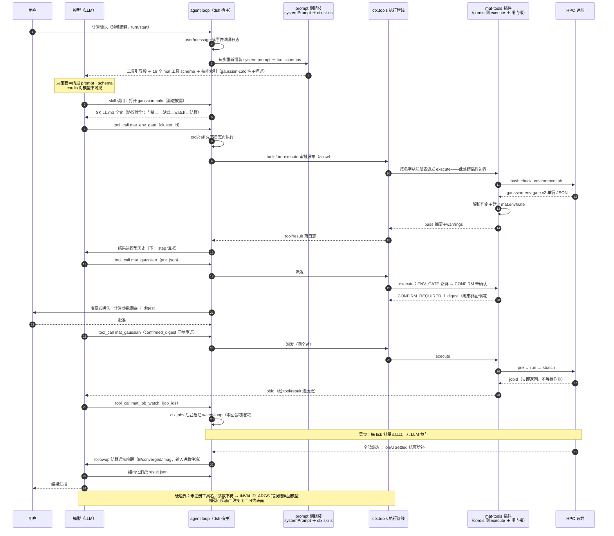
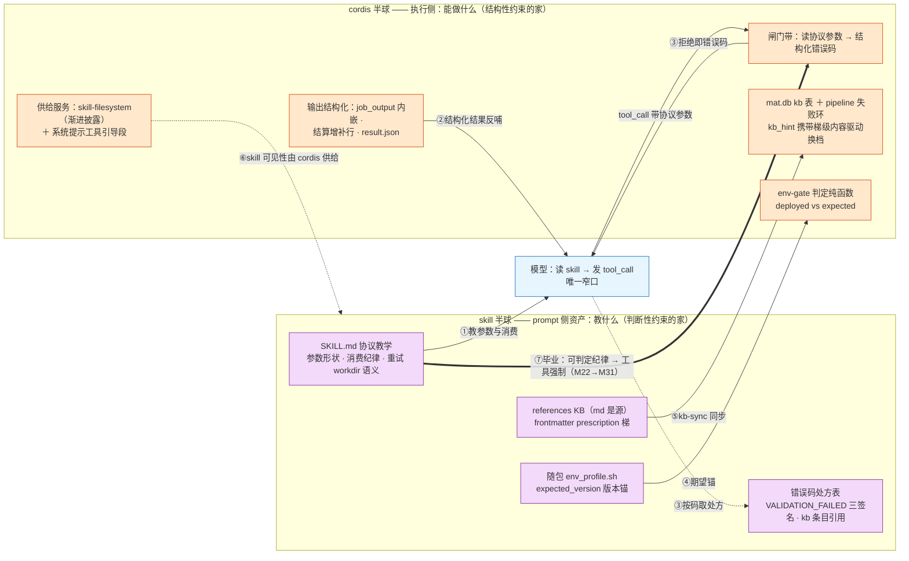

# mat 约束解耦轮计划（constraint-decoupling：门禁机制化 + 约束归位 + 架构终态定稿）

> 前置结论（2026-09-21 架构评审）：三档判据确认现有分层正确——宿主内可逆逻辑归
> cordis 壳（mat-tools）+ 零 cordis 纯函数核（mat-core），跨进程持久事实落远端
> （sacct / `.calcflow-phase.json` / result.json），跨客户端共享约束归远端协议
> （calcflow）。**否决**六插件 cordis 重组（复用轴是引擎不是阶段；破坏零 cordis 核
> 纪律与 fixture 回放）、**否决** watch-loop 守护进程（sacct 即持久事实源，watch 是
> 可重建投影，re-watch / pipeline resume 已覆盖恢复）。真缺口是两条纯散文约束：
> 环境门禁（`check_environment` 在 packages/ 零代码存在，全靠 SKILL.md 散文）与
> log 消费红线（三处散文，无强制）。

**Goal:** 把 skill 里结构性可判定的约束迁入工具层强制（结构化错误码 + 零集群副作用，
照 `BUDGET_REJECTED` 既有范式），判断性约束明示留在 skill 并成文判别式；skill 门禁节
显著瘦身；架构终态图定稿入 d0-architecture。

## 约束归位判别式（总原则，写入 d0-architecture.md）

| 约束形态 | 归位 | 形态 |
|---|---|---|
| 结构性可判定（字段/数字/状态可比） | 工具层闸门 | 结构化错误码前缀 + 拒绝即零副作用 |
| 判断性（怎么做得对，不可枚举） | skill 散文 | 协议纪律 + 典型处方 |
| 跨进程持久事实 | 远端集群 | sacct / phase 文件 / result.json，宿主可随时重建 |
| 跨客户端共享保证 | 远端协议 | calcflow 契约（不拉回宿主） |

推论：skill 里每一条「必须/禁止」要么有对应结构化错误码，要么明示为判断性指导；
「门禁通过」是运行时数据（per-cluster 缓存 + TTL），不是加载期拓扑。

## 架构终态图

图例：红＝约束闸（拒绝面）；紫＝零 cordis 纯函数核；橙＝typed 工具面；粉＝判断性
约束（skill）；黄＝远端持久事实与协议；青＝后台监控/驱动；虚线框＝本轮新增。
所有远端交互必经 exec-gate → MatClient 单通道；宿主内除会话日志外一切可丢弃重建。

## 决策进入路径（时序）——LLM 如何「进入」gaussian 链路

静态图回答「是什么」，时序图回答「怎么进来」。要点：

- **模型从不进入 cordis，cordis 对模型完全不可见。** 决策的唯一进入点是模型输出流里的
  一条 tool_call（name ＋ arguments）；宿主按名字从 ctx.tools 注册表解析 handler 派发
  ——「进入 gaussian 插件」＝一次名字解析。插件只是**提前把自己注册成了模型可调的
  名字**（注册即 effect；卸载即消失，每步重新组装 schema，热重载即时生效）。
- **模型可见面 ＝ 注册面**：未注册工具名或参数不符 → INVALID_ARGS 错误结果回模型。
- **引导决策的三个 prompt 侧通道**（harness 在 cordis「左侧行动」）：① 工具 schema
  自描述；② mat-tools 插件注册的系统提示工具引导段（order 100–199 槽位，领域措辞
  → 工具映射，2026-08-28 证据：改前模型声称无法访问远程，改后「看看作业队列」直取
  mat_exec＋squeue）；③ 技能渐进披露（profile 的 skill-filesystem 扫本仓库
  skills/，gaussian-calc 名＋描述进索引，模型经 skill 工具打开 SKILL.md 接受协议
  教学：先门禁 → 一站式 → watch → 结算纪律）。
- **执行侧**（「右侧行动」）：tool/call 先落日志再执行 → pre-execute 审批瀑布 →
  派发 → 闸门带 → MatClient → 远端 → tool/result 落日志进历史。
- **唯一在请求-响应环外的进入通道**：followup 异步唤醒（watch 结算通知）。

## skill 与 cordis 的协作通道（两半球图）

skill 与 cordis 之间**没有函数调用、没有 import、没有事件订阅**——协作经两个中介中转：
模型（读 skill、发 tool_call）与工具面（schema/参数/输出/错误码）。本质是**契约层协作**：
接口定义是参数 schema、结构化错误码、输出 schema、版本锚、KB frontmatter schema 这五份契约。
七条通道（均有仓库实证）：

1. **教学→参数形状**（skill→cordis，经模型）：skill 教「必须传 task_ref / wave_gate /
   confirmed_digest / attempts_ledger」，闸读同一参数（`openBudgetGate(args.task_ref)`）。
   双层纪律 = skill 协议要求传 ＋ 工具拒绝传错越界。
2. **输出→消费契约**（cordis→skill，经模型）：job_output 内嵌 properties/log_tail/plots、
   结算通知带 E/converged/imag 增补行、result.json 规范化——skill 的「直读字段禁
   grep log」之所以能一句话教成，是因为 cordis 侧先保证字段在。
3. **错误码→处方**（握手）：码在 cordis 侧定义（BUDGET/GATE/PHASE/NEGATIVE_VERDICT/
   VALIDATION_FAILED/ENV_GATE_REJECTED…），处方在 skill 侧维护（L770 三签名处置、kb
   引用）。模型拿码 → 查 skill 处方 → 修正下一次 tool_call。
4. **版本锚**（skill 资产→cordis 判定，数据流）：skill 随包 env_profile.sh 携带
   expected_version；远端报 deployed_version；比较在 mat-core 纯函数。三元组三副本
   同步纪律。
5. **KB 内容管道**（skill 资产→cordis 运行时消费，最深一条）：references/errors/*.md
   是**源**，frontmatter prescription 梯经 kb-sync 进 mat.db kb 表；pipeline 失败环
   运行时读 kb_hint 直接携带梯级内容驱动自动换档。即便这条「直连」，也是经显式
   frontmatter schema ＋ 同步脚本，cordis 从不在运行时读 markdown。
6. **可见性供给**（cordis→skill 的存在条件）：skill 被模型看到本身就是 cordis 服务的
   产物——profile 的 skill-filesystem provider 扫 skills/ 做渐进披露；mat-tools 注册
   系统提示引导段把领域措辞导向工具。skill 不漂浮，由 cordis 供给。
7. **毕业通道**（skill→cordis 生命周期）：约束先以散文落地（改起来快，M1–M31 逐轮
   取证迭代），证明可判定后毕业为工具强制——M22 波间门检散文 → M31 GATE_FAILED；
   M29 确认闸；手工 echo 台账 → attempts_ledger 自动记账。反向也有：工具输出变富
   （结算增补行），skill 散文就删（M5 精简）。判别式决定谁能毕业。

## 约束归位总表（本轮后终态）

| 约束 | 现状 | 终态归位 |
|---|---|---|
| 环境门禁（ok/protocol/版本锚/missing_tasks） | skill 散文 40 行 | 工具拒绝 `ENV_GATE_REJECTED`（A 批） |
| 参数摘要确认 | 工具（M29 CONFIRM_REQUIRED） | 不动 |
| 预算闸 / 相位闸 / 波间门 / 台账 | 工具（M31，参数激活） | 不动（双层纪律成文） |
| log 消费红线（cat/grep/awk/sed/tail/head 对 job.log） | skill 散文三处 | 工具拒绝 `LOG_READ_REJECTED` + 显式豁免（B 批） |
| 重试 workdir 语义 / 路由行核对 / diag 目录契约 / 门禁黑盒禁令 / 播种协议 | skill 散文 | 留 skill，明示判断性（C 批） |
| 收敛校验 / run 不执行二进制 / 相位状态机 | 远端 calcflow 协议 | 不拉回宿主 |

## 分工与重复审计（skill vs cordis）

**分工**：skill 管模型知道什么（判断性约束教学，概率性生效）；cordis 管模型做得出什么
（结构性约束执行，确定性拒绝）。**重复三分解**——感到的「约束分散」是三种性质不同的
东西，处置方向相反：

1. **投影型（健康，保留）**：散文描述已存在的强制（工具闸/远端协议），让模型第一次
   就做对。例：手改 gjf 禁令 ↔ 远端 input_digest；D9 同模式纪律 ↔ 远端契约报错。
2. **双层型（设计内，成对维护）**：四个参数激活闸（task_ref / wave_gate /
   attempts_ledger / confirmed_digest）——schema description 与 skill 协议纪律各写
   一遍参数语义；错误码（工具）↔ 处方（skill）。不可归零：闸是可选参数，skill 必须教
   「传」，工具只能拒「传错的」；收敛路径只有闸无条件化（破坏 ad-hoc 用法）或 P3b
   服务端 frontier。
3. **唯一强制型（病灶，方向反了：投影在、权威缺）**：门禁判据（40 行散文，packages/
   零代码）、log 消费红线（三处散文，无谓词）——→ A 批 / B 批补权威。

**健康度判据**：每一对重复能回答「谁是权威、谁是投影」，权威唯一在代码，投影同步有
纪律（版本锚、三血脉 SOP、md 是源表是索引）。当前不满足的仅上表第三类两处。

**家族内重复**（非 skill↔cordis，记录在案）：版本锚三副本（skill / canonical /
demo env_profile，M 系列每轮手工同步——可加 kb-sync 式脚本对冲）；abacus-calc 整体
镜像 gaussian-calc 范式（公共部分机制化后自然缩小）。

## 相位

### A 门禁机制化（E1，主菜）

- **A1** `packages/mat-core/src/env-gate.ts`（纯函数）：`parseEnvGateStdout(stdout)`
  → `{status:'pass'|'fail'|'seed-needed', verdict?, reason?}`。判定规则照 gaussian-calc
  SKILL.md 门禁节原文：`ok===true && protocol==='new' && missing_tasks 空 &&
  deployed_version===expected_version && errors 空`；`newer_version` 非空 → warning
  透传。非 JSON / 缺 `deployed_version`/`expected_version`/`newer_version` 字段 →
  `seed-needed`（字段集即脚本代数，判旧标准原样迁移）。附 `isEnvGateFresh(entry,
  nowMs, maxAgeMs)`。fixture：SKILL.md 示例 JSON + SCRIPT_NOT_FOUND + 各失败形态，
  照 `test/contract/PROVENANCE.md` 范式落真实录制。
- **A2** `packages/mat-tools/src/env-gate-registry.ts`：进程级缓存
  `Map<clusterId+engine, {verdict, registeredAt}>`；在 index.ts L544-546 旁
  `ctx.provide('mat.envGate', registry)`（对齐 mat.status/mat.files 服务形态）。
- **A3** 新工具 `mat_env_gate`：参数 `{cluster_id, engine?('gaussian'|'abacus'，缺省
  gaussian), workflow_root?, g16_home?, timeout_seconds?(缺省 180)}`。execute：按引擎
  组装远端命令（`.gaussian-calc`/`.abacus-calc` 路径，覆盖参数透传）→ getClient()
  执行 → `parseEnvGateStdout` → pass 登记缓存并返回单行摘要+warnings；fail 返回
  errors 原样不入缓存；seed-needed 返回结构化播种提示（指向 skill 罕见路径）。
- **A4** 接线四入口，拒绝发生在任何集群调用前：`mat_sbatch`（L713 区）、
  `mat_gaussian`（execute 头部 openBudgetGate 旁）、`mat_pipeline_start/resume`、
  `mat_pool_start/resume`。错误形态：
  `ENV_GATE_REJECTED: cluster <id> (<engine>) env gate not fresh (<no pass in this host
  process | pass expired>) — run mat_env_gate first`。`mat_exec` 不设闸（通用通道，
  且门禁脚本自身经它执行——鸡生蛋）。
- **A5** 应急开关（对齐 exec-gate 范式）：`MAT_ENV_GATE=off` 整闸关闭；
  `MAT_ENV_GATE_MAX_AGE_MS` 新鲜度上限，缺省 12h（门禁从 per-session 语义升级为
  per-(host 进程, cluster, engine)+TTL——batch 子代理自动继承主会话门禁，
  batch-roles「门禁第一条继承」从纪律变机制事实）。
- **A6** 测试：core 纯函数单测（pass/四类失败/畸形 JSON/seed-needed/TTL 过期）；
  tools 集成照 R2 范式——execCommand mock「被调即炸」+ `not.toHaveBeenCalled` 断言
  四入口无门禁时拒绝且零集群副作用；登记后放行；off 开关放行。

### B log 红线半机制化（E2，独立可并行）

- **B1** mat-core 纯函数 `isRawLogRead(command)`：命令含 `job.log` 字面量 **且**
  命令词含 {cat, head, tail, grep, awk, sed, less, more, rg} 任一（覆盖管道形态
  `cat job.log | grep`；`ls job.log`、`echo job.log` 不命中）。
- **B2** `mat_exec` 新增可选参数 `read_raw_log: boolean`（描述写明：仅当
  result.json `status=='error'` 且结构化字段不足以定位问题时豁免）。默认命中谓词即
  `LOG_READ_REJECTED: structured result is authoritative — use job_output/result.json;
  pass read_raw_log=true only for error fallback`。`MAT_LOG_GUARD=off` 关闭。
- **B3** 测试：谓词单测（命中/管道/非 job.log 放行/豁免参数/off 开关）。

### C skill 瘦身与判别式成文（E3，A/B 落地后）

- **C1** gaussian-calc SKILL.md 门禁节（L66-112，约 40 行）缩至约 8 行：第一条业务
  命令改 `mat_env_gate` 单工具调用；播种/刷新罕见路径原样保留（heredoc 仍是无凭证
  内容通道）；黑盒禁令保留（防探针浪费往返的行为约束）。三处 log 红线（L178/L608/
  L679）缩为一句引用工具错误码与豁免条件。
- **C2** abacus-calc（L58-61 门禁节）、gaussian-external-input（adaptation 引用）、
  batch-orchestrator（L74/L139）、batch-roles（L19/L55/L100）同步改机制事实措辞。
- **C3** 版本 bump：gaussian-calc `0.7.36-demo`（M32 轮），adaptation 节记录本轮；
  远端 workflow 无改动，env_profile 三副本不动。
- **C4** `docs/d0-architecture.md` 增「约束归位」节：判别式 + 总表 + 终态图。

## 验证清单

| # | 验证 | 手段 |
|---|---|---|
| V1 | 四入口无门禁时拒绝且零集群副作用 | execCommand 被调即炸 + not.toHaveBeenCalled |
| V2 | mat_env_gate 通过后全进程放行；TTL 过期再拒 | 集成测试时钟注入 |
| V3 | seed-needed 路径提示正确（SCRIPT_NOT_FOUND/字段缺失） | fixture |
| V4 | log 谓词命中/管道/豁免全分支 | 单测 |
| V5 | 全量测试 + 契约 fixture 回放绿 | pnpm test |
| V6 | 真实集群冒烟：通过路径 + 断闸拒绝路径 + 播种路径 | 集群实测 |

## 风险与边界

- **破坏性变更**：四工具从「可直调」变「需先门禁」——skill 必须同轮原子更新；
  headless/batch 会话首条命令变 `mat_env_gate`。
- **绕过面**：mat_exec 通用通道可手搓 sbatch——与既有各闸一致的两层纪律（skill
  协议 + 工具拒绝）；彻底不可绕待 P3b 服务端 frontier，不在本轮。
- **B 批豁免参数是诚实开关**：救的是 token/正确性不是安全，散文降为一句话引用。

## 不做清单（评审否决项，防复活）

- 六插件 cordis 重组（mat/conn、env-gate、calc-tools……）——复用轴是引擎不是阶段，
  且破坏零 cordis 核与 fixture 回放纪律。
- watch-loop 独立守护进程——sacct 是持久事实源，watch 是可重建投影；re-watch /
  pipeline resume 已覆盖恢复，守护进程只加部署面。
- calcflow 协议拉回宿主——跨客户端共享保证必须在 Slurm 作业内、协议级。
- per-session 工具面收缩——真有需求时走 dsh preset/isolate 配置层，不动插件结构。
